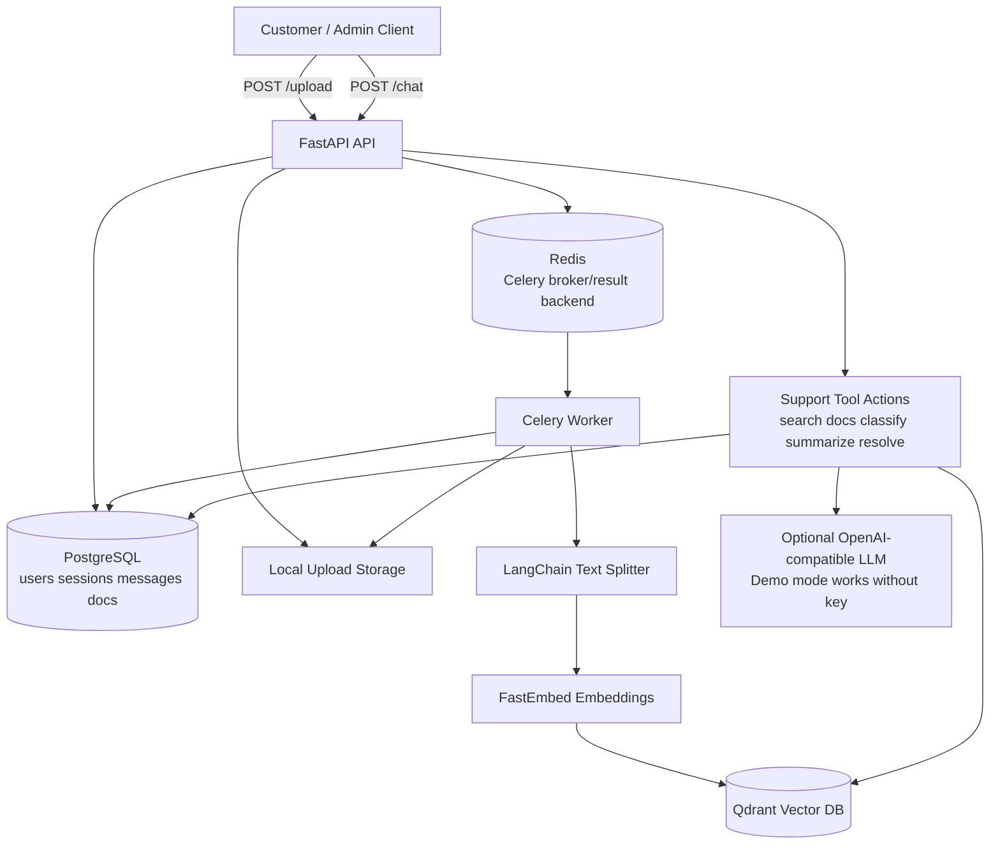

# E-commerce GenAI Support Automation Assistant

A production-style FastAPI project for customer support automation using Retrieval-Augmented Generation (RAG), PostgreSQL, Redis/Celery, Qdrant vector search, and LangChain text splitting.

This is built to look like a serious backend + AI systems project, not a toy chatbot that hallucinates refunds because it read one FAQ and developed executive confidence.

## What this project does

Customers ask support questions. Admins upload FAQ, product, refund, delivery, and account policy documents. The app chunks documents, creates embeddings, stores vectors in Qdrant, tracks metadata in PostgreSQL, indexes asynchronously with Celery, and answers customer queries with grounded citations.

### Core features

- `POST /upload` uploads `.txt`, `.md`, `.csv`, `.json`, and `.pdf` documents.
- Celery background job indexes uploaded documents.
- LangChain `RecursiveCharacterTextSplitter` chunks documents.
- FastEmbed creates embeddings.
- Qdrant stores vector chunks.
- `POST /chat` answers customer questions using retrieved chunks.
- Every answer includes:
  - confidence score
  - grounded / uncertain flag
  - issue classification
  - summarized customer issue
  - resolution steps
  - source citations
- `POST /sessions` and `GET /sessions/{id}/messages` track conversations.
- Admin endpoints list documents, indexing status, and failed jobs.
- Health check validates API, database, Redis, and Qdrant reachability.
- Docker Compose runs the whole stack.
- Pytest tests cover classifiers, chunking, confidence behavior, and API contracts.

## Architecture



## Tech stack

| Layer | Choice |
|---|---|
| API | FastAPI |
| Database | PostgreSQL + SQLAlchemy 2.0 async ORM |
| Vector DB | Qdrant |
| Embeddings | FastEmbed, default `BAAI/bge-small-en-v1.5` |
| Background jobs | Celery |
| Broker/result backend | Redis |
| RAG utilities | LangChain text splitters + LangChain prompt objects |
| Tests | pytest + FastAPI TestClient |
| Deployment | Docker Compose |

## Project structure

```text
ecommerce-rag-support-assistant/
├── app/
│   ├── api/routes/              # FastAPI route modules
│   ├── core/                    # Settings and app config
│   ├── db/                      # SQLAlchemy engine/session/init
│   ├── models/                  # PostgreSQL ORM models
│   ├── schemas/                 # Pydantic request/response models
│   ├── services/                # RAG, Qdrant, chunking, classifiers
│   ├── utils/                   # Storage helpers
│   └── workers/                 # Celery app and indexing task
├── sample_docs/                 # Demo FAQ/policy docs
├── tests/                       # pytest suite
├── docker-compose.yml
├── Dockerfile
├── pyproject.toml
├── .env.example
└── README.md
```

## How to run

### 1. Prerequisites

Install:

- Docker
- Docker Compose v2
- Git, optional but useful because civilization insists on version control

### 2. Create `.env`

```bash
cp .env.example .env
```

Optional: add an LLM key.

```env
OPENAI_API_KEY=your_key_here
OPENAI_MODEL=gpt-4o-mini
```

If you do not add an LLM key, the app still works in deterministic demo mode using retrieved document chunks and rule-based resolution generation.

### 3. Start everything

```bash
docker compose up --build
```

Open API docs:

```text
http://localhost:8000/docs
```

Health check:

```bash
curl http://localhost:8000/health
```

Expected shape:

```json
{
  "status": "ok",
  "api": "ok",
  "database": "ok",
  "redis": "ok",
  "qdrant": "ok"
}
```

### 4. Upload a sample document

```bash
curl -X POST "http://localhost:8000/upload" \
  -F "file=@sample_docs/ecommerce_policy.txt"
```

Expected response:

```json
{
  "document_id": "...",
  "filename": "ecommerce_policy.txt",
  "status": "indexing",
  "celery_task_id": "...",
  "message": "Document accepted. Background indexing started."
}
```

Indexing happens in the worker container. Check status:

```bash
curl http://localhost:8000/admin/documents
```

### 5. Start a session

```bash
curl -X POST "http://localhost:8000/sessions" \
  -H "Content-Type: application/json" \
  -d '{"title":"Refund help"}'
```

### 6. Ask a grounded support question

Replace `SESSION_ID` with the ID returned from the previous command.

```bash
curl -X POST "http://localhost:8000/chat" \
  -H "Content-Type: application/json" \
  -d '{
    "session_id":"SESSION_ID",
    "message":"My order arrived damaged. Can I get a refund or replacement?"
  }'
```

Example response shape:

```json
{
  "session_id": "...",
  "answer": "Based on the uploaded policy documents, damaged items should be reported within 7 days...",
  "issue_type": "product_defect",
  "customer_issue_summary": "Customer reports a damaged order and asks about refund or replacement eligibility.",
  "resolution_steps": [
    "Ask the customer for order ID and photos of the damaged item.",
    "Verify whether the damage was reported within the policy window.",
    "Offer replacement or refund according to the uploaded policy."
  ],
  "confidence": 0.82,
  "grounded": true,
  "citations": [
    {
      "document_id": "...",
      "filename": "ecommerce_policy.txt",
      "chunk_index": 2,
      "score": 0.81,
      "text_preview": "Damaged items must be reported within 7 days..."
    }
  ],
  "fallback_reason": null
}
```

### 7. Test fallback behavior

```bash
curl -X POST "http://localhost:8000/chat" \
  -H "Content-Type: application/json" \
  -d '{"message":"Can you tell me the CEO private phone number?"}'
```

Expected behavior: the system should say it cannot find the answer in uploaded docs and mark the response as ungrounded or low confidence. Finally, a chatbot with enough humility to not invent a CEO hotline.

## API endpoints

| Method | Endpoint | Purpose |
|---|---|---|
| GET | `/health` | API/database/Redis/Qdrant health |
| POST | `/upload` | Upload support documents |
| POST | `/chat` | Ask customer support questions |
| POST | `/sessions` | Create support chat session |
| GET | `/sessions` | List sessions |
| GET | `/sessions/{session_id}/messages` | Read session messages |
| GET | `/admin/documents` | List uploaded documents |
| GET | `/admin/indexing-jobs` | List indexing states and failures |
| POST | `/admin/documents/{document_id}/reindex` | Re-run indexing |

## Failure cases handled

| Failure | Behavior |
|---|---|
| Unsupported file type | `400 Bad Request` |
| Empty extracted text | Document marked `failed` during indexing |
| Qdrant unavailable | Health returns degraded vector status |
| Redis unavailable | Upload may fail to enqueue task; health shows Redis error |
| No relevant chunks found | `/chat` returns fallback answer with `grounded=false` |
| Low confidence retrieval | `/chat` refuses to fabricate and explains uncertainty |
| LLM key missing | Deterministic demo answer generation is used |

## Run tests locally

With Docker services running:

```bash
docker compose exec api pytest -q
```

Or on your machine:

```bash
python -m venv .venv
source .venv/bin/activate
pip install -e ".[dev]"
pytest -q
```

## Useful commands

```bash
# Show API logs
docker compose logs -f api

# Show worker logs
docker compose logs -f worker

# Rebuild cleanly
docker compose down -v
docker compose up --build

# Inspect docs metadata
curl http://localhost:8000/admin/documents
```

## Resume bullets

- Built a GenAI support automation assistant using FastAPI, LangChain, Qdrant vector search, PostgreSQL, Redis, and Celery for document ingestion and retrieval-based customer support.
- Implemented document upload, background indexing, semantic retrieval, issue classification, customer issue summarization, resolution-step generation, confidence scoring, and source-grounded responses.
- Designed session/message storage, document metadata tracking, admin indexing status, health checks, Docker Compose deployment, and pytest coverage for core API flows.

## Interview explanation

> I built an e-commerce support automation backend where admins upload policy/product/FAQ documents and customers ask support questions. Uploads are stored and indexed asynchronously using Celery. The worker extracts text, chunks it with LangChain, embeds chunks with FastEmbed, and stores vectors in Qdrant. The chat endpoint retrieves relevant chunks, computes confidence, classifies the issue type, generates a grounded answer with citations, and refuses to answer when the uploaded documents do not support the query.

## Why this is portfolio-worthy

Most beginner projects stop at CRUD. This project shows backend architecture, async APIs, relational modeling, background jobs, vector search, RAG behavior, observability-style health checks, and defensive fallback logic. In recruiter language: it checks the AI box without being fake glitter glued to a todo app.
